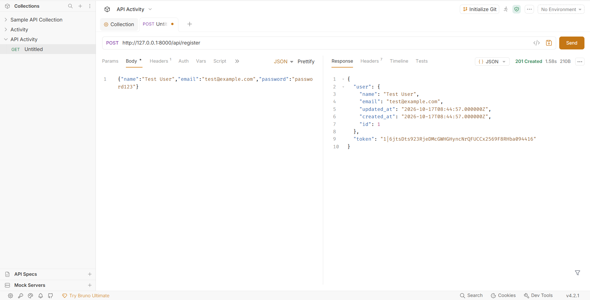
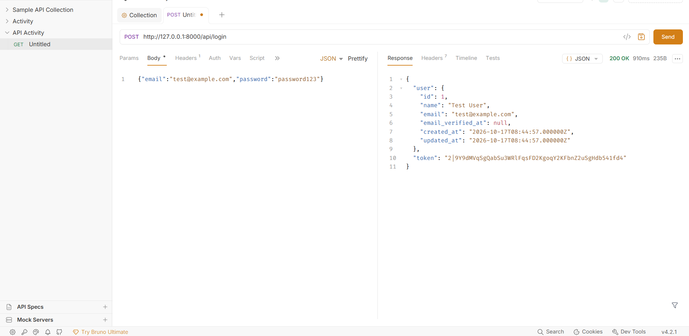
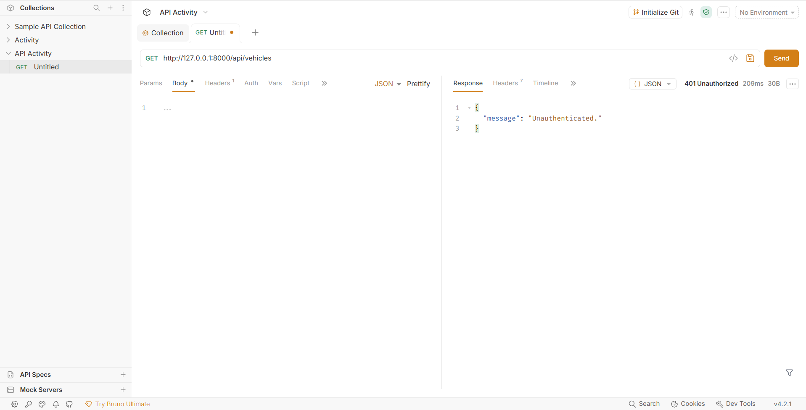
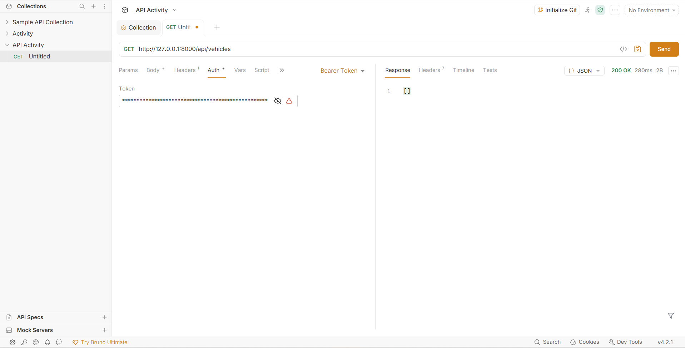
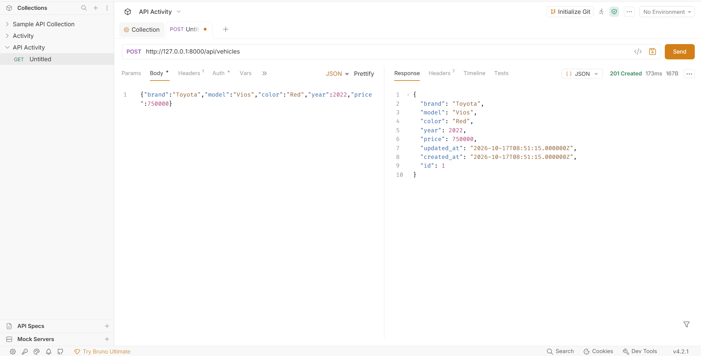
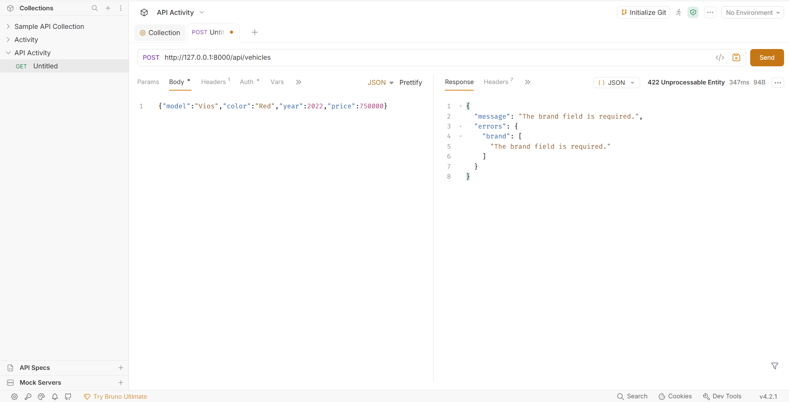
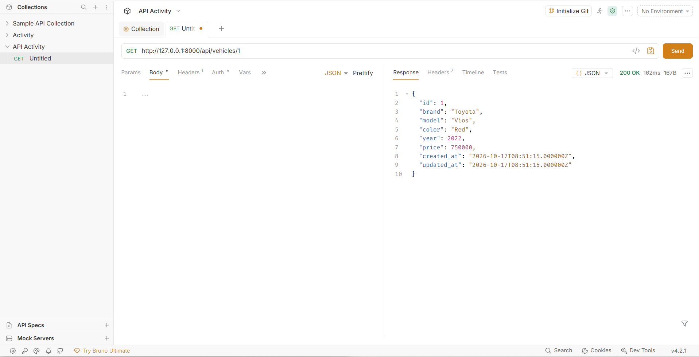
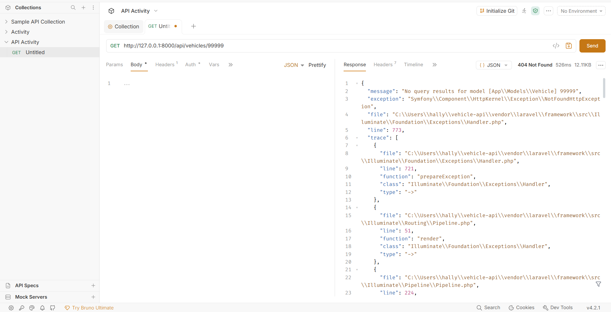
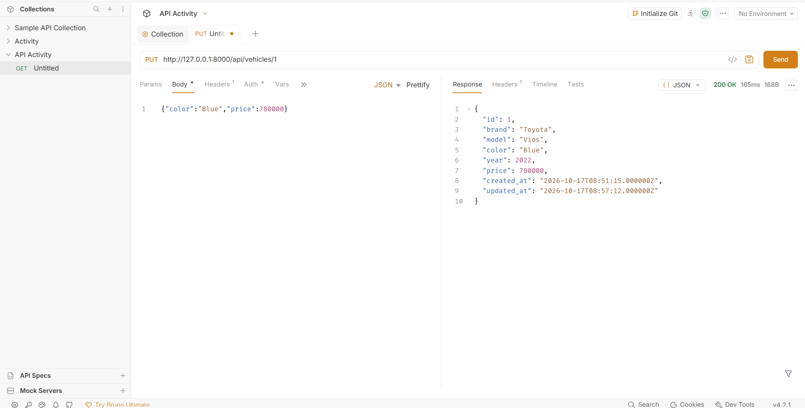
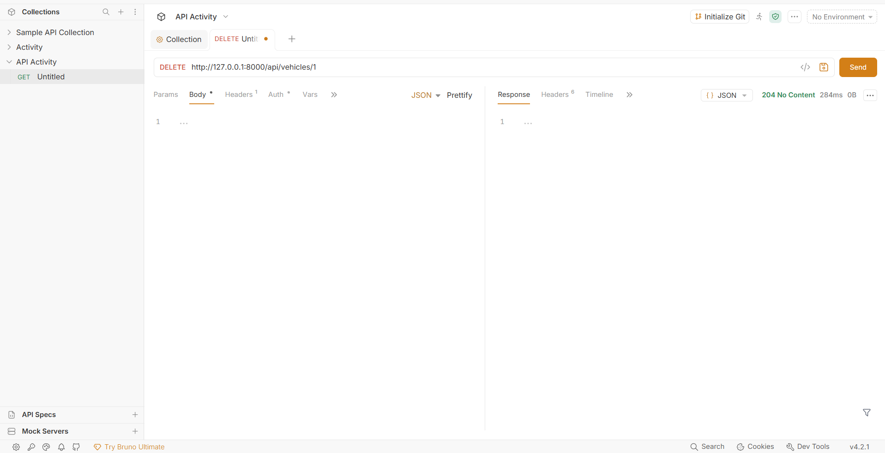

# Vehicle API

- **Project:** Build Your Own API (Laravel + Sanctum + SQLite)
- **Partners:** Cesca Jihanna Aguilar and Hally Kate Laag
- **Section:** IT1E
- **Resource:** Vehicle

| Field | Type |
|-------|------|
| brand | string |
| model | string |
| color | string |
| year  | integer |
| price | decimal |

## Setup (from a fresh clone)

```bash
git clone https://github.com/cescaJ/vehicle-api.git
cd vehicle-api
composer install
cp .env.example .env
php artisan key:generate
touch database/database.sqlite
php artisan migrate
php artisan serve
```

The API runs at `http://127.0.0.1:8000/api`. Send the header `Accept: application/json` on every request.

## Routes

| Verb | Path | What it does | Token? |
|------|------|--------------|--------|
| POST | /api/register | Create a user, returns a token | No |
| POST | /api/login | Log in, returns a token | No |
| POST | /api/logout | Revoke the current token | Yes |
| GET | /api/me | Show the logged-in user | Yes |
| GET | /api/vehicles | List vehicles (filters: brand, model, color, year, price) | Yes |
| POST | /api/vehicles | Create a vehicle | Yes |
| GET | /api/vehicles/{vehicle} | Show one vehicle | Yes |
| PUT | /api/vehicles/{vehicle} | Update a vehicle | Yes |
| DELETE | /api/vehicles/{vehicle} | Delete a vehicle | Yes |

## Screenshots

1. `POST /api/register` → 201
   
2. `POST /api/login` → 200
   
3. `GET /api/vehicles` with no token → 401
   
4. `GET /api/vehicles` with token → 200
   
5. `POST /api/vehicles` valid data → 201
   
6. `POST /api/vehicles` missing required field → 422
   
7. `GET /api/vehicles/1` → 200
   
8. `GET /api/vehicles/99999` → 404
   
9. `PUT /api/vehicles/1` → 200
   
10. `DELETE /api/vehicles/1` → 204
    

## Why does DELETE return 204 and not 200?

In our API, DELETE returns 204 No Content because once the vehicle is deleted, there is nothing left to send back to the client. A 200 OK usually comes with a response body, but the deleted record no longer exists, so a body would not make sense. The 204 status code simply tells the client that the request worked and that no content is expected. When we tested it in Bruno, the response showed 204 with a size of 0B, which proves the server sent nothing back.